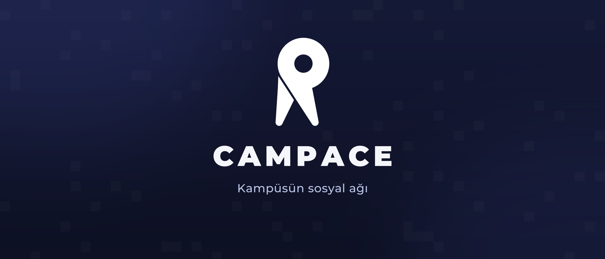
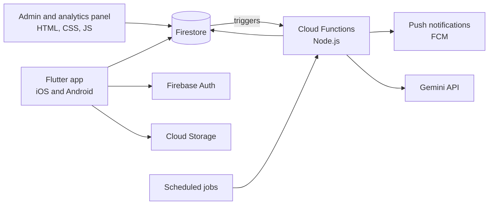

# Campace

**The social network of the campus.** Students find events, clubs, teammates, course notes, jobs and scholarships at their university, in one app.

[campace.app](https://campace.app) · [App Store](https://apps.apple.com/tr/app/campace/id6745303910) · [Google Play](https://play.google.com/store/apps/details?id=com.campace)

> The source code is private. This repository describes the product and how it is built. Built and run by [Mustafa Enes Öztürk](https://github.com/mustafaenesozturk) as the only engineer.

## In numbers

| | |
|---|---|
| Students | 4,400+ |
| Institutions | 67 |
| Interactions | 2.2M+ |
| First public pilot (Gebze Technical University) | 3,000+ users, 60%+ of the campus |
| Production Cloud Functions | 225+ |

## What students use it for

- **Feed:** posts and campus news in one stream, with a campus only view
- **CamBuddy:** find people for sports, study sessions and other activities
- **Tournaments:** campus football tournaments with fixtures, scores, player ratings and match media
- **Course notes:** past exams with solutions, lecture notes and problem sessions
- **Jobs, internships and scholarships:** collected automatically and reviewed before publishing
- **Messaging, events, cafeteria menus and daily mini games**

## Architecture

## Engineering notes

- **No double processing.** Scheduled notifications are claimed inside a Firestore transaction (`scheduled` to `processing`), so two overlapping runs never send the same push twice. Inbox writes use stable document ids, so a retry overwrites instead of duplicating.
- **Fan out that respects users.** Pushes go out in batches of 500 tokens, and broadcasts respect each user's notification preferences and quiet hours on the server.
- **LLM pipelines with a human in the loop.** Scheduled Gemini jobs turn scholarship, job and campaign pages into structured JSON. Results are normalised, deduplicated by content hash and saved as drafts that an admin approves. A lighter model takes over on failure, and a daily quota guard caps cost.
- **Written down invariants.** Rules that fail silently when broken, such as where device tokens live and how deduplication keys are built, are documented next to the code. One of them came from a bug where a function ran without errors and reached no one.
- **Safe releases.** Security rules are diffed against the live version with a dry run before every deploy. Unit tests cover tournament logic (scores, penalty shootouts, ratings), and rules tests check that outsiders cannot read admin data.
- **Data you can trust.** An hourly KPI pipeline feeds the analytics panel. When a report showed a 37% email verification rate, the cause turned out to be a stale denormalised field; the real rate was about 91.5%, and every report that used it was fixed.

## Stack

Flutter / Dart · Firebase (Firestore, Auth, Cloud Functions, Cloud Messaging, Storage) · Node.js · TypeScript · Gemini API · HTML / CSS / JavaScript
